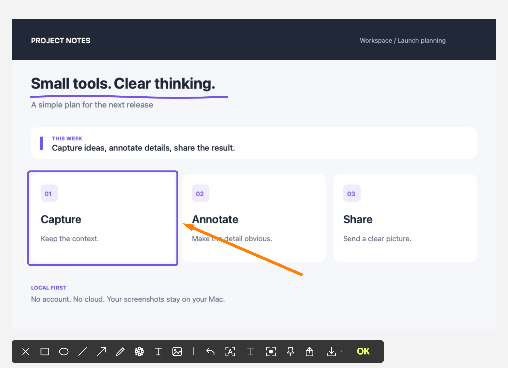
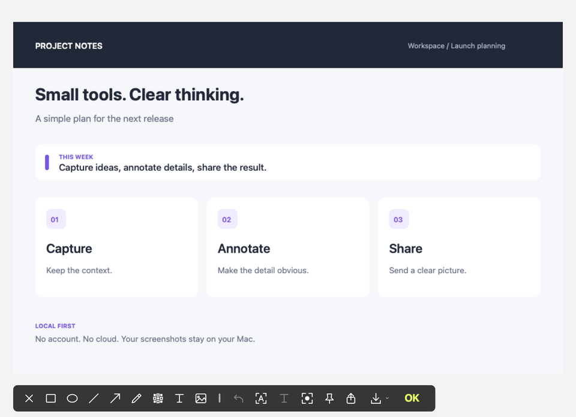
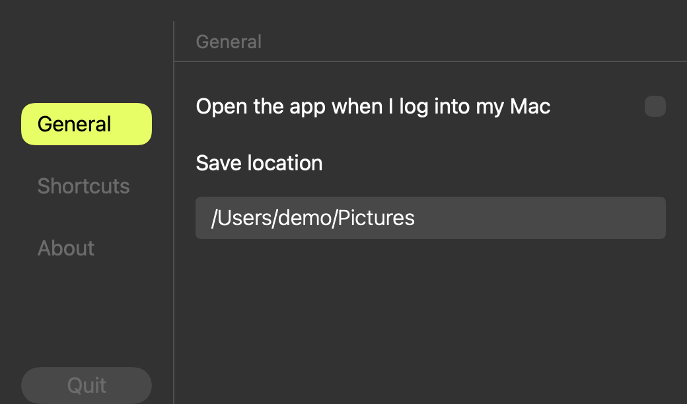
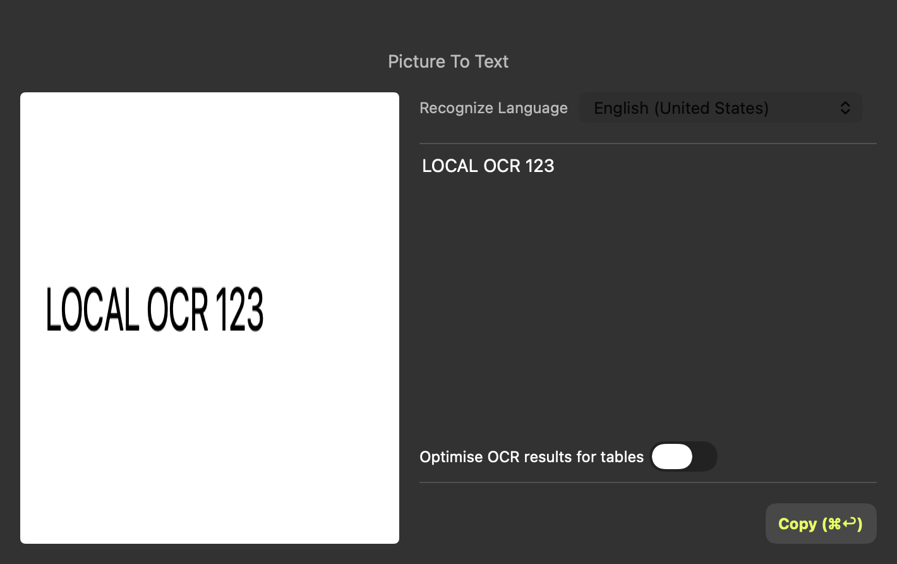

# Screen Shoter Open

An independent, open-source alternative to **iScreen Shoter** for macOS.
Capture, annotate, pin, extract text, and record locally. No account, subscriptions,
analytics, or cloud services. All implemented tools are available for free.

This is an unofficial reconstruction inspired by iScreen Shoter's workflows. It
is not the original app's source code or an official open-source release. The
public build uses its own artwork. It does not claim pixel-perfect equivalence.





[Watch or download the MP4 demo](docs/media/annotation-demo.mp4)

The images and video show production native views with synthetic sample content.
The annotation video is scripted and rendered offscreen. It is not a recording
of someone's desktop. Reproduce the media with `./scripts/render-demo.sh`.

## Features

- Region and window selection, magnification, color sampling, and adjustable capture bounds.
- Rectangle, oval, line, arrow, pen, mosaic, multiline text, stickers, and imported images.
- Annotation movement, resizing, and undo.
- PNG clipboard copy, JPG/PNG/PDF exports, quick save, and the macOS share sheet.
- Screenshot history, animated copy-to-corner previews, drag-out, Finder reveal, and Trash deletion.
- Local Apple Vision OCR with editable results and table formatting.
- Floating pins with preset or custom scale.
- Screen or window recording to H.264 MP4, with optional system audio.
- Custom global shortcuts, save directory, and optional launch at login.

Cloud OCR, translation, purchases, analytics, and the original app's external
recorder integration are excluded. Screen recording is implemented locally.

## Install

Requires **Apple Silicon**, **macOS 14 or later**, and Xcode with its command-line
tools selected. The asset catalog compiler is included with full Xcode.

```sh
git clone https://github.com/Mr-Neutr0n/iscreenshoter-open.git
cd iscreenshoter-open
./build.sh
open 'build/Screen Shoter Open.app'
```

You can also download the app ZIP from [Releases](https://github.com/Mr-Neutr0n/iscreenshoter-open/releases).
The app is ad-hoc signed and is not notarized. Build from source if macOS blocks
the downloaded app. Move the app to `/Applications` before enabling launch at login.

Screen capture requires permission in **System Settings > Privacy & Security >
Screen & System Audio Recording**. Grant it to **Screen Shoter Open** and reopen
the app if macOS requests it. OCR runs entirely on your Mac.

## Shortcuts

| Action | Default |
| --- | --- |
| Screenshot | Command + Shift + A |
| OCR capture | Command + Shift + T |
| Copy in editor | Command + C |
| Save in editor | Command + S |
| Quick save in editor | Command + Return |
| Undo in editor | Command + Z |
| Cancel capture/editor | Escape |

Change the global shortcuts in Settings. Quit other apps that own the same
combination. Failed registrations retry when another application exits.

Copying a capture now shrinks and moves it into the corner with the native macOS
window animation. [Motion evidence and validation](docs/MOTION.md).

## More screenshots

| Settings | OCR |
| --- | --- |
|  |  |


[Palette appearance correction](docs/PALETTE.md).

## Build and verification

No third-party packages are needed. The project builds with `swiftc` and `actool`.

```sh
./verify
```

Verification builds and checks the signature, then exercises annotation rendering,
crop orientation, toolbar geometry, previews, Settings, pin layout, asset loading,
shortcut registration, JPG/PNG/PDF export, Vision recognition, and H.264 encoding
with decoded frames. Tests use synthetic content and do not grant screen access.

These checks do not prove live desktop capture, system audio, shortcut delivery
between applications, drag receivers, or behavior on every display arrangement.
Some popup placement, focus, animation timing, and alternate pin interactions
still need manual testing. See [development notes](docs/DEVELOPMENT.md).

## Privacy

Captures and recordings stay on your Mac. Cached images are stored beneath
`~/Library/Caches/org.hari.screenshoter.open/Image`. Exports use your selected save
folder. The app has no networking client, account system, telemetry, or updater.

## Contributing and license

Small fixes and reproducible bug reports are welcome. Include your macOS version,
Mac architecture, action sequence, and expected result. Please use synthetic
content in screenshots.

The implementation and generated resources are [MIT licensed](LICENSE).
See [resource provenance](THIRD_PARTY_NOTICES.md) for the scope of that license.
